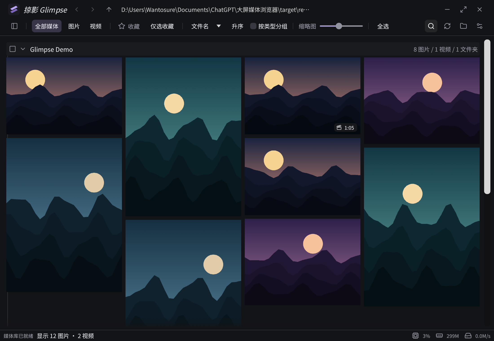
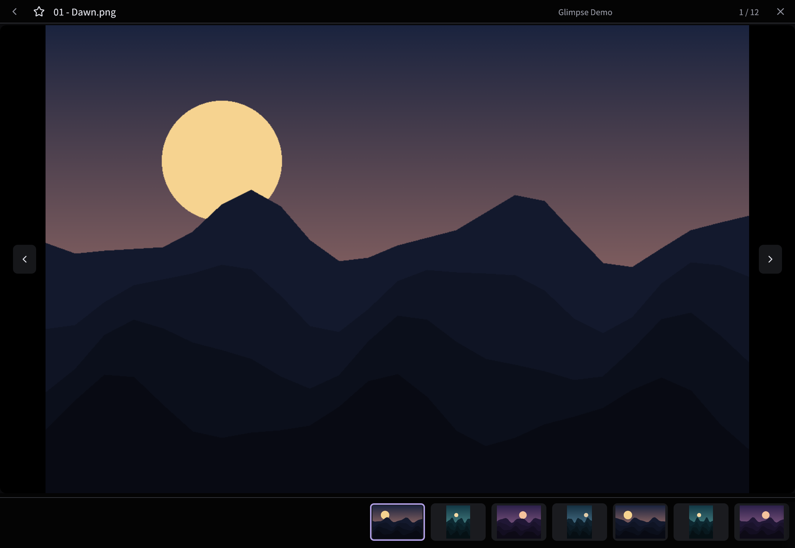
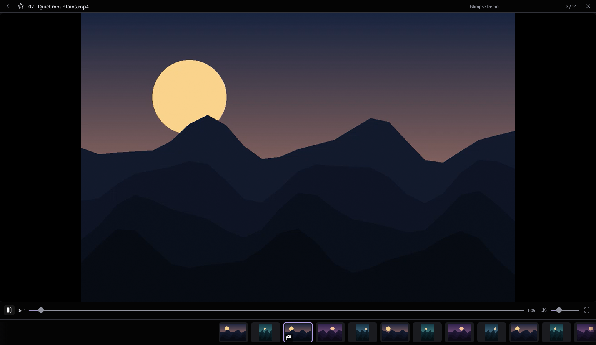
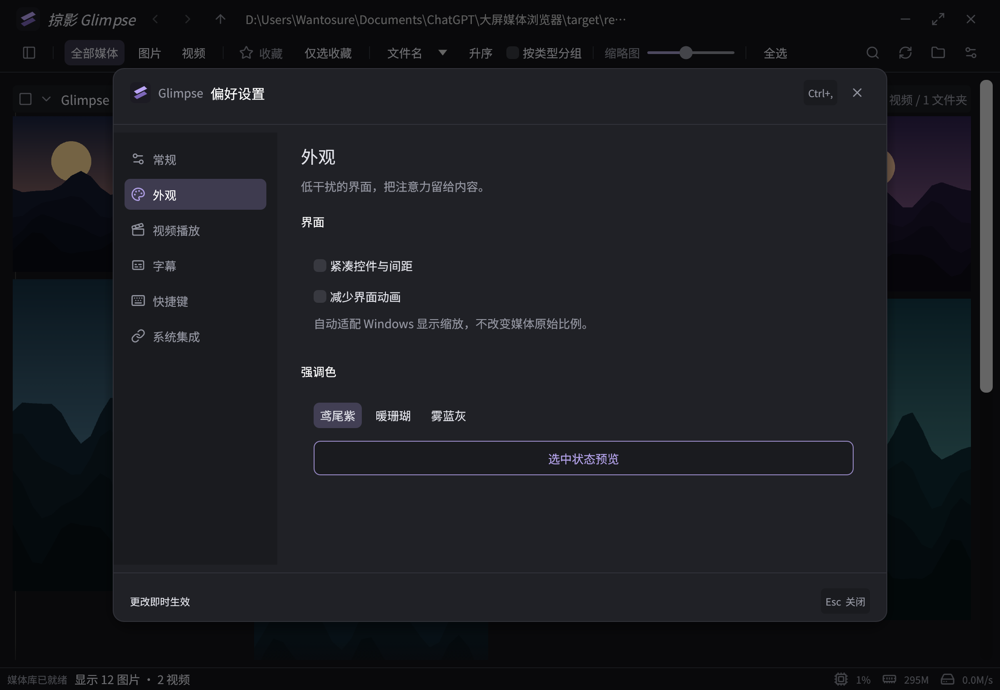
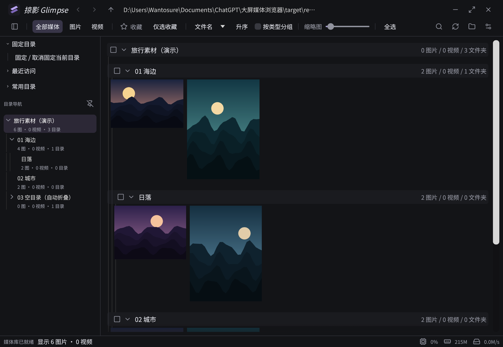
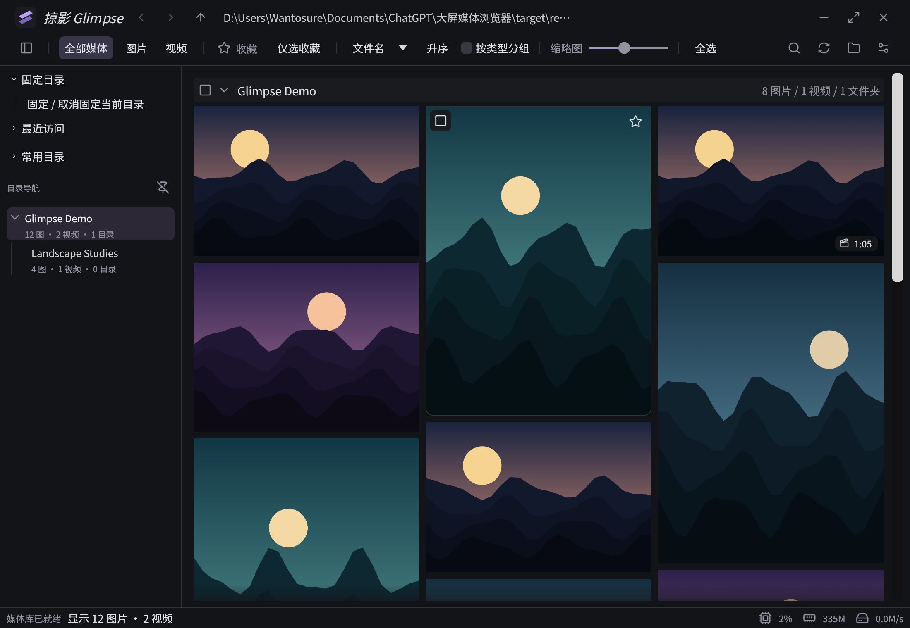

<p align="center">
  
</p>

<h1 align="center">掠影 Glimpse</h1>

<p align="center"><strong>把文件夹里的图片和视频，连起来看。</strong></p>
<p align="center">面向 Windows 的原生桌面媒体浏览器 · 图片与视频混排 · 悬停播放 · 大图详情 · 收藏筛选</p>
<p align="center">
  <a href="#适合用来做什么">使用场景</a> ·
  <a href="#界面预览">界面预览</a> ·
  <a href="#主要亮点">主要亮点</a> ·
  <a href="#子目录如何展示与加载">子目录浏览</a> ·
  <a href="#115-与局域网盘支持">115 与局域网盘</a> ·
  <a href="#如何开始">如何开始</a> ·
  <a href="https://github.com/wantosure-cmd/glimpse/issues">反馈问题</a>
</p>



掠影直接打开磁盘中的文件夹，将图片、动图和视频放在同一个浏览界面。沿着目录结构浏览素材，在列表中预览视频，单击进入详情，再用收藏和多选留下需要的内容。适合希望在一个窗口里连续翻看混合媒体的人。

> **当前源码：0.4.51，正在核验的 v0.5 稳定性候选。** 最新已交付本地测试包为0.4.50，尚未发布可公开下载的安装包。完整性能与跨系统验收仍在进行，具体进度见[v0.5推进记录](docs/v0.5公开测试版推进.md)与[当前状态](#当前状态)。

## 适合用来做什么

| 场景 | 掠影能帮你做什么 |
| --- | --- |
| 创作素材初筛 | 在同一页查看参考图、照片与视频，悬停预览视频，再收藏或批量选择。 |
| 照片与录像回看 | 按文件夹连续浏览图片和录像，在详情中前后切换、缩放查看、控制视频播放。 |
| 设计参考与长图阅读 | 保留图片比例浏览，打开超长 PNG 查看细节，按收藏筛选参考内容。 |
| 多层目录中的素材查找 | 使用悬浮目录导航、吸顶路径和媒体位置跳转，减少在空文件夹之间滚动。 |
| 115 与局域网盘浏览 | 打开 CloudDrive2 挂载的 115 目录，或 NAS、路由器硬盘等 SMB 共享，在同一界面浏览图片和视频。 |

## 界面预览

以下为 **0.4.46 原生程序实际渲染截图**，使用专门生成的山景插画与演示视频，不含私人照片。截图用于展示界面，不能代替性能或媒体兼容性验收。[截图来源说明](docs/images/README.md)

### 把空间留给图片

详情页提供紧凑信息栏、前后翻页和底部缩略图，支持图片缩放、长图查看与收藏。



### 视频直接在详情中播放

视频画面嵌入原生窗口，时间、播放进度、音量和全屏控制位于同一行；底部继续保留图片与视频的混合导航。



### 按浏览习惯调整

设置按常规、外观、视频播放、字幕、快捷键和系统集成分类，提供中文与英文界面。



## 主要亮点

- **连续浏览混合媒体**：图片、GIF 和视频共用列表与详情序列，支持类型筛选、自然排序和按类型分组。
- **列表里就能预览**：视频悬停播放并提供进度控制；GIF 进入可见区域自动播放，离开可见区域释放播放资源。
- **大图渐进加载**：先显示小预览，再补充清晰图；长 PNG 使用总览与可见区域补清，减少一次性展开整张长图的内存开销。
- **目录导航更直接**：悬停展开导航、吸顶祖先路径、按滚动方向跳到有媒体的位置；已确认整棵子树无媒体的目录默认折叠，可在设置关闭。
- **收藏与批量筛选**：支持收藏、只看收藏、范围选择、全选与沿鼠标轨迹多选；提供路径复制及 Windows 文件复制、剪切操作。
- **完整的查看流程**：支持逐项或成组轮播、下一项有界预加载、同名 SRT 字幕与字幕样式设置。
- **本地原生运行**：Rust + egui/glow 界面，libmpv 内嵌 GPU 视频；扫描与解码在后台执行，按视口优先调度，并对缓存和任务数量设定边界。

另外提供最近访问、常用与固定目录、命令面板、自定义快捷键、外部文件变化监听、加载问题说明及重试。文件删除优先使用回收站，支持的照片格式可执行旋转；具体操作范围见[文件夹导航](docs/渐进预览与文件夹导航.md)与[旋转说明](docs/云盘快捷键与旋转.md)。

## 子目录如何展示与加载

**打开一个父文件夹，就能在主列表里连续浏览它和多层子目录中的媒体，无需逐个进入子文件夹。** 列表保留目录层级：父目录在前，同一子树的内容连续排列，每个目录标题下面展示该层的图片和视频，而不是把所有文件混成一个没有来源的列表。



*0.4.46 实际截图：左侧同时显示“旅行素材 → 海边 → 日落”的层级，右侧连续展示各层媒体；“空目录”分支自动收起。素材为本地生成的演示插画。*

例如，打开“旅行素材”后，主列表的结构相当于：

```text
旅行素材                         ← 根目录标题
  [根目录中的图片和视频]
  海边                           ← 子目录标题，可折叠
    [海边目录中的图片和视频]
    日落                         ← 更深一层的子目录
      [日落目录中的图片和视频]
  城市
    [城市目录中的图片和视频]
```

- **边扫描，边展示**：后台递归枚举目录，分批把已发现的媒体加入列表，不等待整棵目录扫描完成才开始展示。缩略图和视频封面优先为当前可见位置加载，图片渐进补清，不会因为扫描到某个目录就立即解码其中全部原图。
- **有层级，也能连续滚动**：目录行显示该层直属图片、视频和子文件夹数量；缩进与层级线标明关系。滚动时，当前祖先路径合并为吸顶面包屑，便于知道自己正在看哪个目录。
- **空分支默认收起**：扫描确认整棵子树都没有图片或视频后，默认折叠该分支；自身没有媒体、但后代有媒体的目录仍保留展开。扫描中或读取失败的目录不会直接当成空目录。可在“设置 → 常规 → 目录导航”关闭此选项，也可手动展开。
- **定位不必重新打开目录**：悬浮目录导航、目录名称和吸顶路径用于定位列表中的目录；显式“打开文件夹”可将其设为新的浏览根。吸顶条右侧浮动箭头按最近滚动方向，跳到前一个或下一个有媒体的位置。

折叠控制列表展示，不代表后台不再扫描该子树。大目录首次枚举、尺寸读取及快速滚动后的补齐速度仍受文件数量、磁盘和网络状态影响。规则与验证记录见[默认折叠与目录层级](docs/0.4.41本地测试验收.md)。

## 115 与局域网盘支持

**掠影可以通过 Windows 文件路径浏览 115 挂载盘和局域网共享。** 先让目标目录在资源管理器中正常可访问，再在掠影中选择同一个文件夹，即可使用混合列表、详情查看、视频预览和收藏等浏览功能。

| 来源 | 如何打开 | 连接由谁负责 |
| --- | --- | --- |
| **115 网盘，经 CloudDrive2 挂载** | 先在 CloudDrive2 登录 115 并挂载为盘符，再打开类似 `U:\115\旅行素材` 的目录。 | CloudDrive2 负责账号鉴权、云端请求、缓存及同步；掠影通过挂载路径访问文件。 |
| **局域网 SMB 共享** | 直接打开类似 `\\NAS\Media\旅行素材` 的共享路径，或先映射为 `X:\旅行素材` 再打开。 | Windows、NAS 或路由器负责共享连接、访问权限与网络传输。 |
| **本地硬盘 / 移动硬盘** | 直接选择对应磁盘上的文件夹。 | Windows 文件系统负责文件访问。 |




*浏览布局实际截图，使用本地生成素材演示。115 或 SMB 路径可访问后沿用这套界面；此图并非真实网盘连接、加载速度或兼容性验证截图。上方流程图说明两种连接方式。*

### 115 挂载盘

掠影已实现针对 CloudDrive2 虚拟盘路径的兼容处理，无需在掠影内再次填写 115 账号、Cookie 或密钥。索引和缩略图缓存保存在本机应用数据目录；打开未缓存内容时，挂载驱动可能触发下载，实际流量和缓存策略由驱动决定。使用在线内容需要网络，不能将挂载浏览理解为整库已离线。

历史构建已对真实 CloudDrive2 挂载的 115 目录完成只读扫描、内嵌视频播放与快进专项验证，见[CloudDrive2 使用与验证](docs/云盘快捷键与旋转.md)。**当前候选尚未完成真实网盘复测，切换下一视频的等待与黑屏问题仍在核验中。** 此支持方式通过外部挂载实现，掠影没有内置 115 账号登录或直连 API。

### 局域网盘 / NAS / 路由器共享硬盘

支持将 SMB 共享作为浏览根，父目录及子目录沿用同一套列表和后台扫描方式。共享需要先完成 Windows 登录并具备读取权限；访问失败时请先检查资源管理器是否能够打开同一路径。

项目已有真实局域网共享目录的专项记录，但**网络录像慢起播与远距离跳转仍存在未解决项**，不能承诺与本地 SSD 相同的体验。首次出图、视频封面、起播和拖动进度均可能受网络延迟、共享设备性能及文件索引结构影响。历史问题与试验记录见[网络录像专项](docs/0.4.20网络录像专项第二轮.md)，不作为 0.4.46 已通过网络性能验收的证明。

挂载盘上的云端变更能否及时通知由驱动或共享实现决定，列表未更新时可手动刷新。旋转、删除和回收站能力也取决于目标文件系统；上述真实网络目录专项以只读浏览为主，不代表云盘写入、删除或多端同步均已验收。

## 媒体支持

| 类型 | 当前实现范围 |
| --- | --- |
| 静态图片 | JPEG、PNG、WebP、BMP、TIFF、HEIC / HEIF 等；不同编码、位深及方向信息的覆盖情况分别记录。 |
| 动图 | GIF；详情支持动态 APNG，包括 `.png` / `.apng`。 |
| 视频 | 通过内嵌 libmpv 播放，覆盖 MP4、MOV、MKV、AVI、3GP / 3G2 等常见容器的测试场景。 |
| 字幕 | 同目录同名 SRT 自动加载，支持手动选择与样式调整。 |

扩展名不等于全部编码组合均已验证。格式与特殊文件限制见[媒体格式验证矩阵](docs/媒体格式验证矩阵.md)、[动图说明](docs/0.4.36本地测试验收.md)和[长 PNG 说明](docs/0.4.39本地测试验收.md)。

## 如何开始

### 普通用户

目前仍处于本地测试阶段，仓库没有附带便携版、安装器、运行库或真实测试媒体。正式公开下载尚未开放。

已经取得完整测试便携包时，将整个 ZIP 解压到本地目录后运行 `media-browser.exe`，点击打开文件夹即可浏览。请保留程序旁的 `runtime` 等文件；单独复制 EXE 不能组成完整运行环境。

基本操作：

| 操作 | 用途 |
| --- | --- |
| 单击媒体主体 | 进入图片或视频详情。 |
| 左上角勾选 / Ctrl / Shift | 单项切换或范围多选。 |
| 星形按钮 | 收藏或取消收藏；顶部可切换只看收藏。 |
| Esc / 详情返回按钮 | 返回列表，保留浏览位置。 |
| 空格 / 单击视频画面 | 暂停或继续播放。 |
| Ctrl+K | 打开命令面板。 |
| Ctrl+, | 打开偏好设置。 |

快捷键可在设置中调整。删除、清理和旋转会操作文件，使用前请核对当前选中项与提示。

### 开发者

目标平台为 **Windows 10/11 x64**，使用 `rust-toolchain.toml` 锁定的 Rust MSVC 工具链、Visual Studio C++ 构建工具和 Windows SDK。Mac / Linux 桌面版尚未交付或验证。

```bash
git clone https://github.com/wantosure-cmd/glimpse.git
cd glimpse
```

首次构建需要准备 Cargo 依赖和清单锁定的原生运行库；本仓库不包含完整离线工具链。请按[Windows 构建说明](docs/Windows构建说明.md)和[原生依赖与本地打包](docs/构建说明.md)准备环境，再执行构建，不能将裸 EXE 当成便携发行包。

## 当前状态

源码0.4.51正在进行日常流程与发布准备。已交付的0.4.50补齐普通媒体10秒撤回，并包含后台删除、文件夹排序、紧凑视频底栏及纯视频全屏；其应用45通过/3忽略、库112通过/1忽略与真实专用副本回收恢复记录见[0.4.50验收](docs/0.4.50普通媒体删除撤回验收.md)。这些记录只代表对应构建，不替代0.4.51的本轮验证；当前进度统一见[v0.5推进记录](docs/v0.5公开测试版推进.md)。上方截图仍为明确标注的0.4.46历史界面。

仍需完善的重点：

- 快速滚动后整屏媒体补齐、再次访问首屏以及视频长帧的稳定性，完整性能目标尚未全部达成。
- 真实网盘中的下一视频切换体验；后台预读与封面交接已有实现，真实网络环境的黑屏问题尚未闭合。
- 当前构建的完整格式与性能矩阵、安装卸载、干净系统、系统 DPI 和实体输入 / 音频听感验证。
- 面向公开二进制发行的依赖、许可证与分发资料整理。

历史构建的成绩不代表当前候选已通过同样验收。完整性能、第二台干净GPU电脑与真人试用仍需独立完成。

## 文档与反馈

- [项目交接与开发入口](docs/项目交接.md)
- [产品需求与技术方案](产品需求与技术方案.md)
- [Windows 构建说明](docs/Windows构建说明.md)
- [历史 README 与阶段记录](docs/README历史记录.md)
- [第三方依赖与许可证](docs/第三方依赖与许可证.md)

欢迎通过 [GitHub Issues](https://github.com/wantosure-cmd/glimpse/issues) 反馈问题。请附软件版本、Windows 版本、复现步骤、预期与实际表现；媒体问题可补充格式、尺寸或编码及本地 / 挂载目录类型。公开截图和日志前请去除私人路径与内容，优先提供可公开的最小样本。

## 许可证

**应用许可证尚未决定，当前没有授予开源许可。** 仓库公开用于展示源码与开发进展，不应据此推定获得修改、再分发或商用授权。第三方代码、字体、图标和运行库遵循各自许可证，具体见[依赖清单](docs/第三方依赖与许可证.md)。
