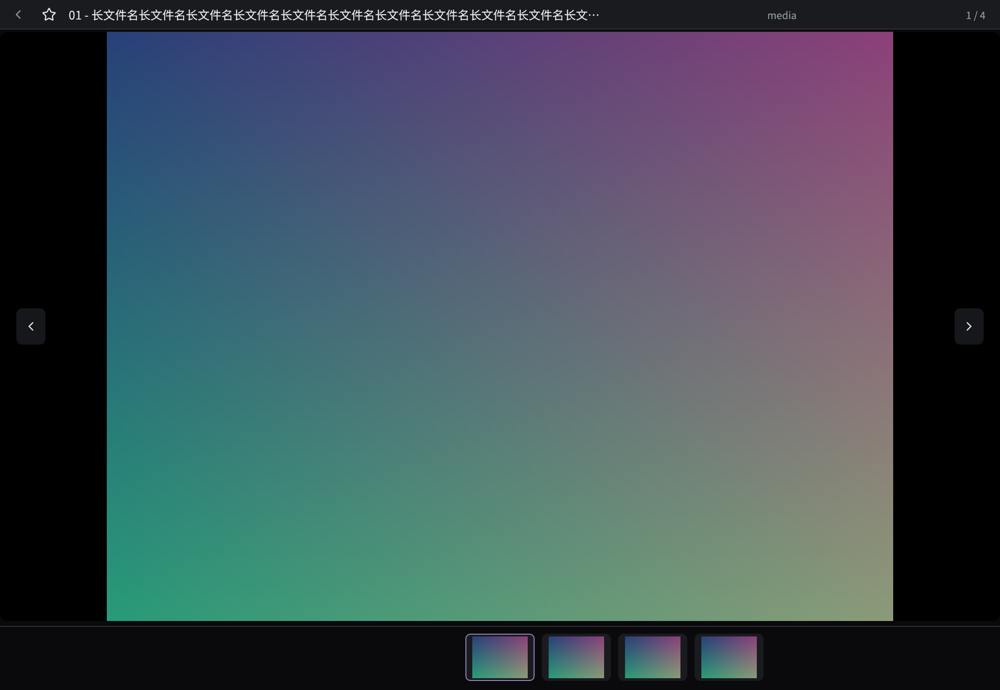

# 0.4.21 本地测试验收

日期：2026-10-25。仅本地测试，应用许可证未由用户决定，无公开发布/上传。

主程序SHA256：`c4a9c55460e3769358168e9062face9e36be91570640e706230ed511aaf72e77`。安装器基础程序SHA256：`a3f771a63f916894f873d1e508ec23d5ca7dab9a7930e916c91fe50693c7cf0f`。最终载荷/ZIP哈希见交付目录delivery.json与SHA256SUMS，当前安装和独立源码结果以同目录verification为准。

0.4.21已冻结本地测试候选，主程序SHA256 c4a9c55460e3769358168e9062face9e36be91570640e706230ed511aaf72e77。库89通过/1忽略，程序36通过/2忽略；同构建原生设计/缩放、目录锚点、多选收藏、播放输入、外部变化、旋转、回收站和24格式通过。压力复测未达标：4K快滑整屏0/10，120秒回调P95冷/再访47.79/47.70ms，20组首屏清晰P95冷/再访2060.48/1718.30ms；视频混合回调43.64ms、WS601.43MiB。不将历史候选的较好值代替本构建结果。界面/视口本轮已用2/3方案，第三种未使用；视频专项1/3，未追加网络方案。

详情顶部预留32pt，不覆盖媒体。返回、收藏、截断文件名、目录、项数同排；标题/目录完整内容通过提示查看。下面是生成样本的真实原生FBO截图，无用户私人媒体。

## 当前同构建证据

核心总索引：artifacts/win11-v0421-local-core-regression.json，checks_pass=true，full_acceptance=false；格式24/24通过，5084源文件哈希与840视频硬链接身份检查通过。测试范围为受控输入/原生FBO，不能替代实体键鼠、显示器呈现、音频听感或HDR参考。

性能整组：artifacts/win11-v0421-frozen-performance-execution.json，采集完成而验收未通过。真实Downloads正常桌面单次到底部首张516.827ms、可见清晰1224.709ms；3张超大PNG超出既有256MiB解码分配限制，complete=false，不增内存限或误称损坏。4K5000照片是固定重复样本，不是5000独立原片；视频840硬链接来自84源文件。20对首屏门禁一致不等于性能通过。原始失败、离群值、此前较好候选及同c4背景观察分别保存，不挑选替代当前值。

同c4关闭/启用视图复用的32秒复核，回调P95为48.0015/48.3598ms、整屏均0/10；Win32采样显示两组全程后台、未最小化。没有自动激活窗口或修改系统设置。背景因素原因未确定，不能据此剔除失败，也未证明缓存是回退根因。后续可选择明确前台条件复核，再使用本轮剩余1种视口方案；本报告不宣称加载专项完成。

## A01–A24，保留原标准

| 项目 | 当前范围与缺口 |
| --- | --- |
| A01 递归分组 | 原生多层目录/树导航通过；真实Downloads只读1048媒体/13678目录，复杂库完整矩阵未全验。 |
| A02 取消/迟到 | 库测试及原生正常退出通过，保留generation/fingerprint/有界队列；实体中断矩阵未全验。 |
| A03 计数/不完整 | 原生目录计数、生成样本外部变化通过；完整ACL矩阵未全验。 |
| A04 排序 | 库排序和原生命令入口通过；全部属性组合未全验。 |
| A05 过滤 | 原生图片/收藏过滤及库测试通过；完整实体组合未验。 |
| A06 单击/多选 | 原生收藏、多选、拖选、复制剪切通过，选中样式增强；实体拖选/Explorer粘贴未全验。 |
| A07 视频预览 | 原生悬停、离开暂停、列表/详情播放通过；实体听感未验。 |
| A08 滚轮/侧键 | 原生滚轮、图片侧键、自定义快捷键通过；视频外侧键保持无操作，实体设备未验。 |
| A09 返回/隔离 | 新顶栏与canvas分离，原生留白返回、控件滚轮隔离及导航通过；实体完整矩阵未验。 |
| A10 默认声音 | 原生播放/静音/音量流程及格式信号通过；设备切换和听感未验。 |
| A11 seek | 原生输入/播放与格式seek通过；物理呈现P95未验，不沿用旧逐帧读回值。 |
| A12 跨组定位 | 原生名称定位、折叠/展开锚点、吸顶折叠与动效通过；原失败与诊断协议修正保留。 |
| A13 Delete | 生成副本原生删除/失败保护/恢复通过；真实图库未删除，实体长按未验。 |
| A14 回收保护 | 库锁定/指纹/恢复及生成副本回收流程通过；完整实体矩阵未验。 |
| A15 HEIC | 当前24格式包含HEIC并通过；真实iPhone10-bit/HDR完整参考未验。 |
| A16 视频格式 | 24格式、MOV实际FBO旋转像素、播放推进与seek通过；不代表全部编码变体。 |
| A17 外部变化 | 生成副本新增/替换/移除/刷新与锚点通过；实体中断条件未全验。 |
| A18 性能 | 未达标。冻结快滑整屏0/10；首屏清晰P95冷2060.48/再访1718.30ms；120秒回调47.79/47.70ms；视频43.64ms、601.43MiB。原标准不变，背景观察不抵销失败。 |
| A19 路径/权限 | 中文长名原生样本和真实目录只读通过；完整ACL/长路径矩阵未全验。 |
| A20 缓存/索引 | 库/主程序测试、首屏新缓存/再访门禁通过；跨进程损坏完整组合不沿用旧通过。 |
| A21 Shell/实例 | 本构建未重新验证主作用域Explorer转交；运行中旧实例保护必须遵守，不绕过锁。 |
| A22 离线包 | 本机完整载荷、独立源码重建、实际安装/卸载待同包verification核对；干净Win10/11离线机未验。 |
| A23 DPI/命中 | 原生100/150/200%与820→1550逻辑宽度3→6列通过；非物理系统DPI/多屏证明。 |
| A24 损坏/退出 | 原生格式错误提示/恢复及诊断正常退出通过；崩溃/强杀/系统关机完整矩阵未验。 |

`full_acceptance_pass=false`。本阶段本地交付不等于完整首版验收。版本一致性、安装与源包重建均须有同包verification结果；失败/未验证不得改成通过。运行中用户旧实例不得自动关闭，安装器若拒绝则保留结果并等待用户手动退出。安装无需管理员或运行期网络；源码包含完整应用源码、文档、工具与生产资源，但不含Cargo依赖vendor全集，不承诺缺工具链/缓存的首次离线编译。真实图库、缓存和本机私人截图不随包。
