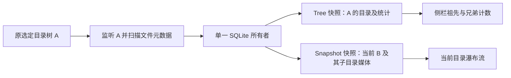

# 目录树计数与子目录视图

## 修复的问题

此前进入子目录后，列表只刷新子目录，但侧栏保存旧祖先快照；兄弟目录变化不会触发当前视图的扫描，祖先总数也不会更新。现在把“当前浏览目录”和“原选定的目录树”分别保存，二者仍由同一个索引线程、同一份 SQLite 数据计算。

`LibraryService::open_view(B, Some(A))` 允许 B 为 A 的真实后代。工作线程规范化并检查目录，扫描 A，用 `Repository::snapshot_for(B)` 查询 B，用 `Repository::snapshot()` 查询 A。目录与文件范围依赖实际父子关系的 SQL 递归查询，不使用字符串前缀匹配。B 位于 A 之外时将新树重置为 B；显式重新选择根目录也重置树。

`LibraryEvent::Tree` 更新侧栏和监听范围；`LibraryEvent::Snapshot` 更新当前列表。两种事件都校验 generation，当前目录下的选择、详情和逻辑序列不会包含兄弟目录的媒体。回收请求仍以当前浏览根目录为边界。

扫描、回收和目录完整性变化会重算目录树。仅宽高、时长等媒体元数据变化只发布当前视图，不重新构建未变化的整树快照。根视图与树根相同时共用同一个 Arc 快照。待发布队列最多保留最新的树/视图消息，结果通道继续有界。

当前浏览子目录消失而祖先仍存在时，可以继续核对祖先树，当前视图返回空媒体并保留不可读取提示；新目录树不会复用旧 generation 的结果。无法读取的目录仍使用既有的保守缓存/不完整状态，未因为扫描错误批量删除未核对的数据。

## 性能边界

进入子目录后核对仍会枚举原选定树 A 的文件元数据，以保持祖先和兄弟统计正确；不会仅扫描 B，也不会解码或预生成整棵 A 的媒体缩略图。缩略图仍只按当前视图及邻近预取请求生成。该策略有整树元数据扫描成本，最新构建的五千媒体性能需另测，不能沿用早期构建数字声称无性能影响。

## 测试范围

新增索引测试验证子树范围、真实父子聚合和同名前缀兄弟不能越界。服务测试用真实生成 PNG 的专属副本核对：祖先/兄弟新增、ID 保留、目录重命名后当前视图为空、树外切换重置以及源字节不变。另一个服务测试验证仅元数据更新不会额外发布 Tree。

扩展 `run_watch_smoke.ps1` 在标记目录内创建 40 份子目录 JPEG 副本和含真实 MP4 副本的兄弟目录；程序化进入子目录后再修改子目录及兄弟目录。记录当前 41→42 张图片、祖先 81 图/1 视频→83 图/1 视频，再删除兄弟目录专属图片变为 82 图/1 视频。当前目录始终只有自己的图片，选择保留，滚动位置为 300，锚点偏差 0。手动刷新同样收敛。旧有 40→41→40 的监听、同名替换、移除清选择/详情与刷新回归仍保留。

`run_trash_ui_smoke.ps1` 现在先打开专属祖先目录，再进入 media 子目录。六批真实回收流程每次核对祖先总数和当前视图数量一致；失败项仍留在原处，成功的六份副本从系统回收站恢复并检查字节一致。该检查验证回收与新作用域配合，不操作用户资源库。

图片/视频计数测试独立于播放兼容性证明，视频副本没有因为被计数就算播放验收。新增 SQL 测试中的文件记录仅是数据层输入，也不作为真实格式证明。原生操作仍为程序化/合成输入，未替代物理鼠标和键盘验收。

Debug 与 Release 检查已通过。当前同构建七组原生回归及完整 56 项测试通过、3 项忽略，以 `artifacts/p4-current-verification.json` 为准；原始树计数位于 `p4-watch-ui.json` 的 `tree_rows`，回收计数位于 `p4-trash-ui.json` 各行的 `tree_media`。

当前 Release SHA256：`6817C29794148BC45DFE8AA70890C36D25CE4E2C378963AA3B8434A939175DE0`。已查看 `p4-watch-tree-added.png` 的实际祖先/兄弟/当前目录计数和稳定失败窗口截图。尚未做人工漏通知、网络盘、复杂目录 ACL 等更广异常验收，P4 不标完整通过。
